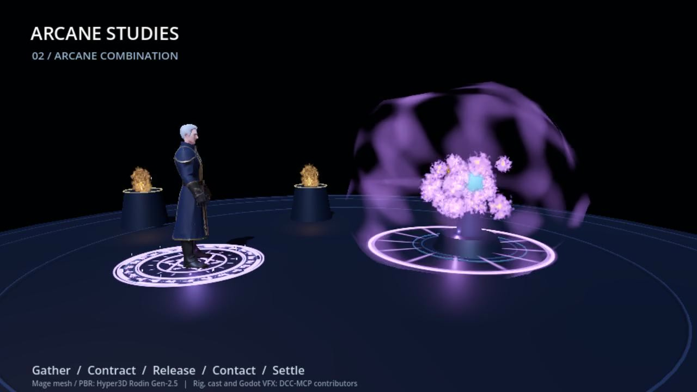

# Godot Shader usage manual

Create an editable shader effect, connect it to a character's animation, and
carry the saved resources into another game. This manual is separate from the
short agent skills. No video tutorial, downloaded texture pack, or model service
is required for the default examples.



Actual Godot 4.7.2 Forward+ frame from the mage study. Mesh/PBR: Hyper3D Rodin
Gen-2.5. Rig, casting animation and Godot effects: DCC-MCP contributors. This
frame predates the sound addition; it is visual evidence only. The model is an
optional demonstration input and is not included in the Python skill package.

## Install and connect

The VFX additions are a candidate in [PR #97](https://github.com/dcc-mcp/dcc-mcp-godot/pull/97),
not a published release. Install the reviewed source checkout with
`python -m pip install -e .`; the version printed by the package alone does not
identify these unmerged changes. Record its commit as well.

Follow [the installation lifecycle](../install.md): plan the addon installation
against an existing `project.godot`, inspect the dry-run, install within the
project's authority, and verify the ready editor/bridge. Do not overwrite a
foreign receipt or infer readiness from registration. An ownership conflict
requires resolving that project identity before further bridge calls.

```sh
dcc-mcp-cli list
dcc-mcp-cli load-skill godot-shader --dcc-type godot
dcc-mcp-cli describe create_fire_vfx
```

Use the discovered instance and returned tool identifiers. The following JSON
blocks are **tool arguments**, not standalone shell commands. An editor scene
with a `Node3D` root must be open. Paths stay under `res://`.

## First mesh fire

Call `create_fire_vfx`:

```json
{"parent_path":".","name":"Campfire"}
```

The returned node contains a subdivided cylinder, a ShaderMaterial, two seeded
noise textures and a gradient. Retain the returned node path. Call
`get_shader_params` with that path, then `set_shader_param`:

```json
{"node_path":"Campfire","parameter":"scroll_speed","value":1.1}
```

```json
{"node_path":"Campfire","parameter":"dissolve","value":0.5}
```

The setter returns `updated`, `parameter`, and the read-back `value`.
`get_shader_params` returns a `parameters` dictionary. These are tool result
fields; inspect the actual transport envelope and errors as well.

Save with the existing scene tool, reopen it, and compare parameter values.
Authoring the effect does not automatically save it. Add a camera/environment
and run a real renderer to judge appearance; headless parsing cannot prove
visible fire or glow.

## Parameters and failures

| Input | Meaning and starting value |
| --- | --- |
| `scroll_speed` | Rising flow, `0.65` |
| `noise_scale` / `detail_scale` | UV tiling, `[3,1.4]` / `[5,2]` |
| `erosion` / `edge_softness` | Breakup and soft edge, `0.4` / `0.08` |
| `sway` / `twist` | Vertex motion, `0.18` / `0.9` |
| `emission_strength` | Emissive brightness, `1.6`; bloom is renderer dependent |
| `dissolve` | `0` visible to `1` vanished |
| `color_ramp` | Saved `GradientTexture1D` path for another palette |

The uniform setter accepts finite scalars, booleans, exact-length numeric
vectors, `#rrggbb` / `#rrggbbaa` colors, and `Texture2D` project paths. Explicit
`null` clears a texture. It rejects missing values, unknown uniforms, wrong
vector lengths, nonfinite numbers and resources outside the project.
Matrices, uniform arrays, boolean/integer vectors and other sampler types are
unsupported. Range hints guide editing; they are not an animation clamp.

| Observed failure | Next action |
| --- | --- |
| No ShaderMaterial | Inspect the target node/material slot before setting uniforms |
| Shader parameter not found | Read the declared uniform names; do not guess a spelling |
| Sampler requires Texture2D | Import the texture, check its type and use its `res://` path |
| Fire requires Node3D parent | Select an owned Node3D in the edited scene |
| New VFX directory rejected | Choose an unused destination; installation will not overwrite it |
| Black or missing rendered effect | Check shader errors, camera bounds, texture generation and renderer |

## From shader to a reusable spell

Load `godot-vfx` and call `install_combat_vfx_library`:

```json
{"directory":"res://combat_vfx"}
```

Its result includes `presets`, `gallery_scene`, `files` and
`main_scene_changed:false`. The six native presets are `mesh_fire`,
`particle_fire`, `attack_slash`, `spell_impact`, `magic_aura` and
`fire_projectile`. Copy the whole installed directory to retain relative
dependencies. These scenes run without the adapter. A fire created directly
by `create_fire_vfx` still points to the addon shader; use the portable preset
or replace that shader reference before removing the addon.

For the character demonstration, `create_spellcasting_demo` accepts a new
`directory`, optional `mage_path`, `auto_cast` and `tint`. Omit `mage_path` for
the procedural character. An imported model needs the documented `Cast`
animation and `RightCastSocket` skeleton bone; a static GLB alone is not a rig.
See [the character contract](../src/dcc_mcp_godot/skills/godot-vfx/references/mage-casting.md).

Keep the production sequence explicit:

1. Verify model scale/orientation, skinning, embedded textures and source rights.
2. Tune shader silhouette and particle erosion at the intended gameplay camera.
3. Bind release to the actual animation event. The example releases at `0.90`
   animation seconds in a `1.85` second presentation clip; those are example
   timings, not universal attack windows.
4. Spawn at the hand socket; use world-space flight and exclude caster bodies.
   Set `impact_on_arrival=false` when an empty destination should be a miss.
5. Drive impact visuals and sound from contact. The game owns damage, buffs,
   cooldowns, networking and cancellation.
6. Replace the demo's optional `charge_sound`, `release_sound`, `impact_sound`
   streams with licensed audio as needed. Defaults are generated PCM cues;
   `sound_enabled=false` suppresses new cues. Check the actual mix and timing.

The slash/impact/aura contract is `play()`, `stop()` and `finished`; persistent
auras can replay with `auto_free=false`. The projectile starts inert and has
its own one-use `launch(target, excluded_bodies)` contract. Mesh/particle fire
are ambient presets, not one-shot combat state machines. Do not hide these
differences behind a generic damage or ability API.

## Save, export and acceptance

- Save the scene and all external resources; exit and reopen in a separate
  Godot process. Compare exported values, material isolation and dependencies.
- Exercise hit, miss, repeated casts, early stop, caster removal and level
  cleanup. Check visible and audible responses at natural playback speed.
- Export the intended target using [platform packaging](../src/dcc_mcp_godot/skills/godot-export/references/platform-packaging.md).
  Run that export separately. A PCK or native editor run does not establish a
  standalone executable, Web browser, or physical phone pass.
- Use project DCC-CUA for actual UI/input. Bind provider, runtime, PID and HWND
  before observation or input; rendered artifacts are a different evidence path.

Set a target-device budget before shipping. For example, declare 1280×720 at
60 fps, a 16.7 ms total frame budget, a separately chosen VFX allocation, maximum
simultaneous effects/lights, and p95/p99 CPU/GPU frame-time and memory limits.
These are proposed test inputs, **not measured guarantees**. Compare warmed
baseline and effects under the gameplay camera; report transparent screen
coverage and worst overlapping bursts. Reduce fill, lights and particle counts
before adding pooling. A desktop Mobile renderer is not a phone benchmark.

Current evidence includes six-preset native checks, separate-process
save/reopen, repeated casts/contact-only feedback/cleanup, a fresh extracted
project run, native Forward+ frames, and a Windows debug export that launches
headlessly. Custom audio resources also survive save and separate-process
reopen. The export launch does not establish windowed input or audiovisual
acceptance. The existing local bridge fixture has
an ownership-receipt conflict. Ordinary input, Web/mobile export, target-device
performance and human audiovisual acceptance remain separate unverified gates.
The manual and a Draft PR do not mean release or deployment.

## Circle study: what is known and what remains to match

The requested [Magic Spell Circles in Blender](https://www.youtube.com/watch?v=aw28EasRtdE)
reference has an author-described fantasy/science-fiction pair, an emissive
circle material and a Geometry Nodes particle simulation. The retained public
description lists these chapter starts; they are **chapter labels, not measured
effect timings**:

| Source time | Author's chapter | Review status |
| --- | --- | --- |
| 00:00 | Demo | Full motion unavailable |
| 00:14 | Magic Circle Material | Description only |
| 05:38 | Particles | Description only |
| 15:10 | Sci-Fi Variation | Description only |

The thumbnail shows nested bright rings, radial marks, geometric motifs and
rim sparks against a dark floor. It cannot establish ring angular speed,
particle acceleration, reveal order, exposure curves, or exact light/shadow
behavior. The retained player response required login; the later public-page
fetch was also unavailable. No subtitle or time-coded filmstrip was obtained.
Do not treat the current study as a verified high-fidelity reconstruction.

The next visual comparison needs actual reference frames at reveal, peak and
settle, plus uninterrupted natural-speed playback. Compare ring hierarchy and
readability at gameplay distance, independent rotation/reveal envelopes,
foreground/background particle occlusion, restrained bloom, floor/character
illumination, and tail cleanup. These are our production criteria, not claims
about unseen tutorial steps. Record each difference before tuning it.

Blender's node graph and render settings do not transfer directly. In Godot,
retain the composition principle using editable ShaderMaterial masks,
GPUParticles3D, AnimationPlayer envelopes and local lights. The runtime owns
duration, contact and cleanup. Source textures and the author's project have
separate rights; neither is bundled. See [production sources](vfx-production-sources.md).

Official references: [spatial shaders](https://docs.godotengine.org/en/stable/tutorials/shaders/shader_reference/spatial_shader.html),
[ShaderMaterial](https://docs.godotengine.org/en/stable/classes/class_shadermaterial.html),
[GPUParticles3D](https://docs.godotengine.org/en/stable/classes/class_gpuparticles3d.html),
[Animation](https://docs.godotengine.org/en/stable/classes/class_animation.html),
[AudioStreamPlayer3D](https://docs.godotengine.org/en/stable/classes/class_audiostreamplayer3d.html).
Historical design research is retained in [production sources](vfx-production-sources.md).
